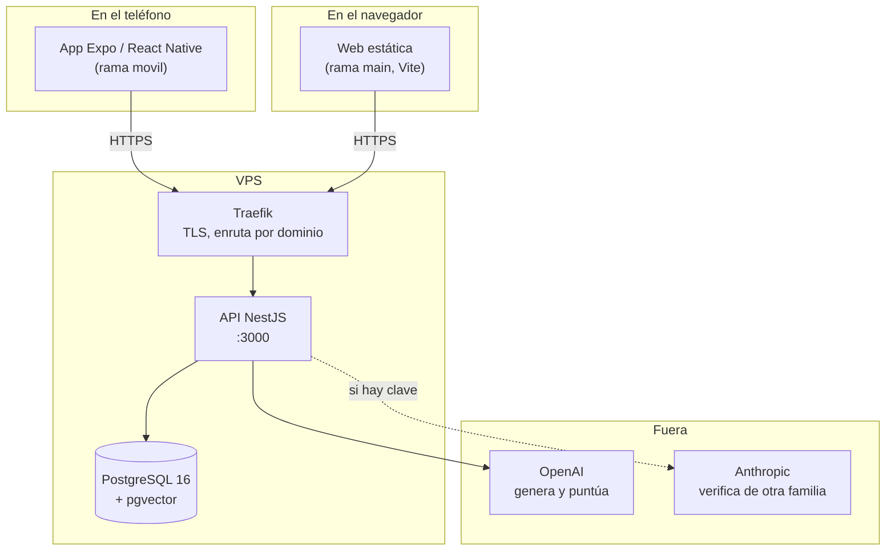
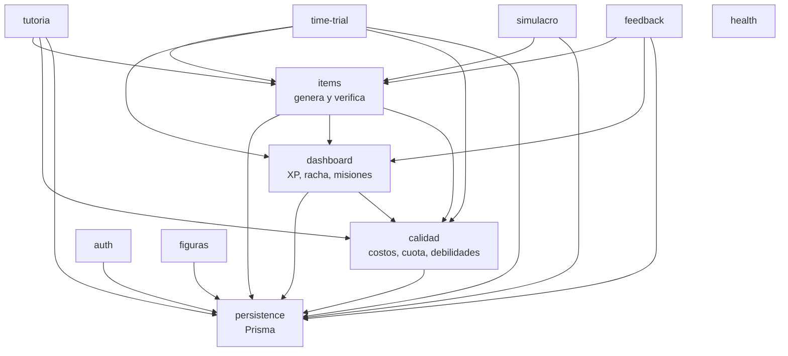
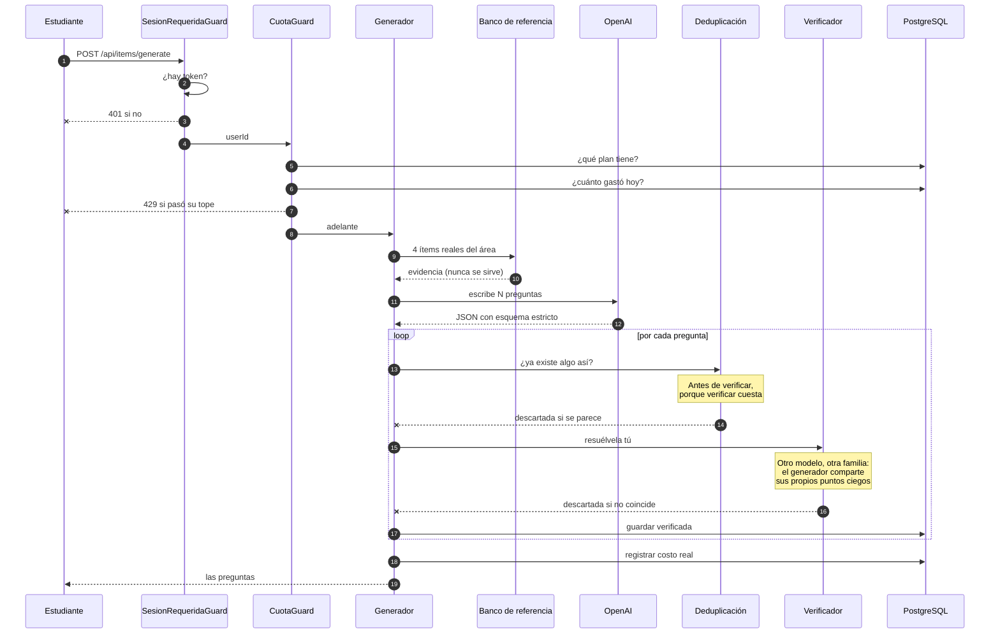
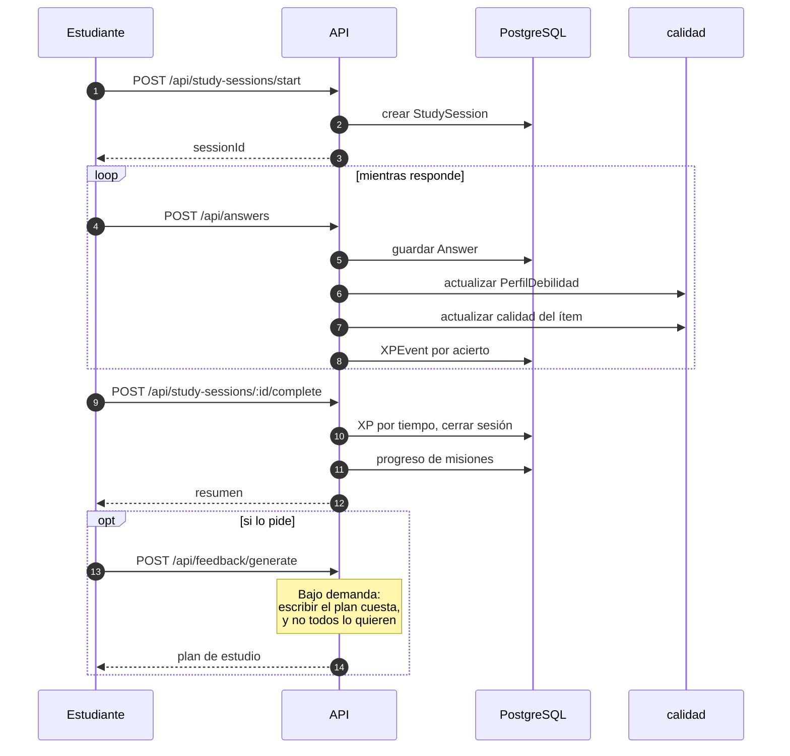
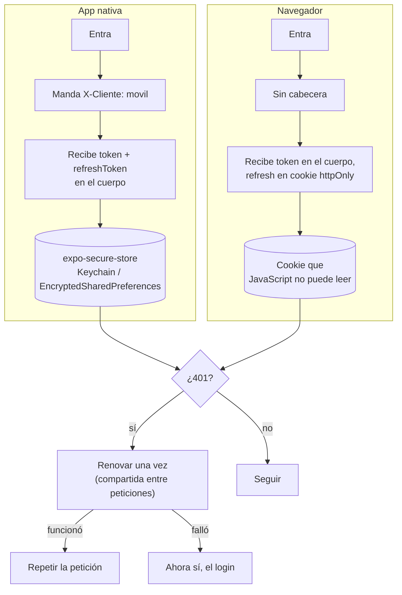
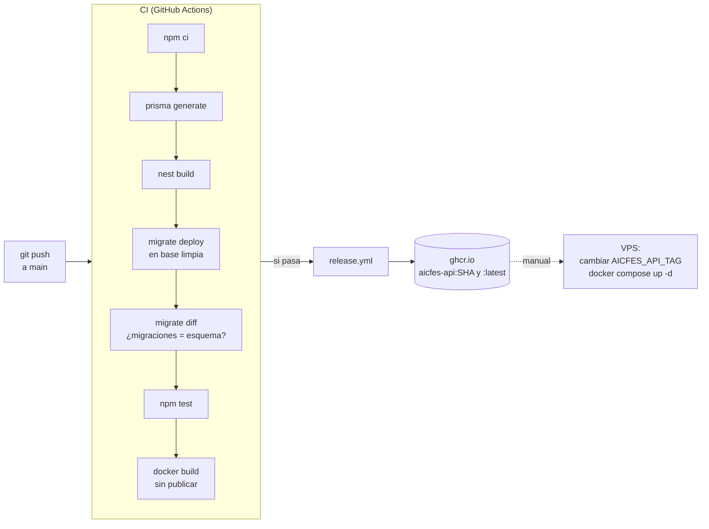
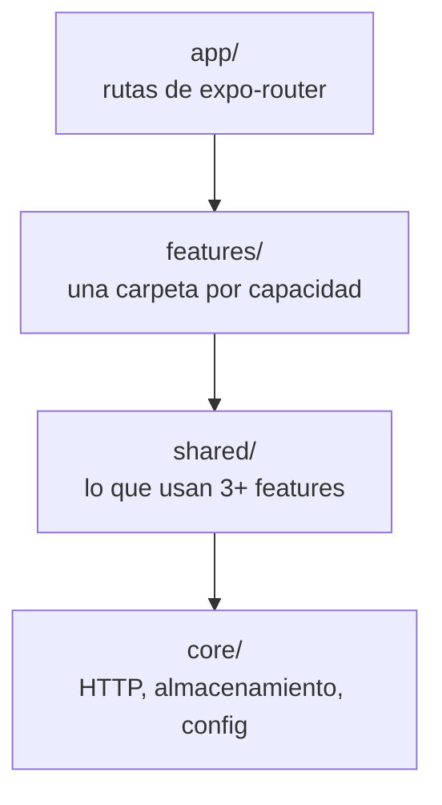

# Arquitectura

Qué hay, cómo se conecta y por qué. Los diagramas son Mermaid: se
renderizan solos en GitHub y viven en git como texto, así que no hay
una imagen que se quede vieja sin que nadie lo note.

Todo lo que sigue se leyó del código, no de la memoria. Si algo no
coincide, el código manda y esta página está mal.

---

## El sistema completo

Traefik y la red `edge` se crean **fuera de este repo**: el compose
solo declara sus etiquetas. Ni la API ni Postgres publican puertos, así
que lo único alcanzable desde internet es lo que Traefik enruta.

---

## Los módulos y quién depende de quién

Leído de los `imports` de cada `*.module.ts`.

`health` no importa nada, a propósito: tiene que poder responder cuando
lo demás esté roto. (Hoy no consulta la base, lo que significa que puede
decir 200 con Postgres caído — anotado como deuda.)

**Por qué `calidad` es su propio módulo:** tanto el generador como el
panel registran medidas. Si la medición viviera dentro de cualquiera de
los dos, los dos se importarían mutuamente.

---

## Generar una pregunta

El camino que cuesta dinero, con el orden que lo abarata.

Dos decisiones que el diagrama hace visibles:

**La deduplicación va antes de la verificación.** Verificar cuesta una
petición a un modelo; descartar un duplicado no cuesta nada. Al revés
se pagaría por validar algo que se iba a tirar.

**El verificador es de otra familia de modelos.** Un generador que se
verifica a sí mismo comparte sus propios puntos ciegos.

---

## Responder y que cuente

El plan de estudio **no** se genera al terminar. Cuesta una petición a
un modelo, y alguien que acaba de terminar puede querer irse.

---

## La sesión del estudiante

Dos clientes, dos formas de guardar el token, por la misma razón de
seguridad en cada caso.

**Por qué distinto en cada uno:** en el navegador, una cookie `httpOnly`
es inalcanzable para un XSS. En el teléfono no hay cookies fiables, y el
almacén del sistema operativo es más seguro que una cookie, no menos.

**Por qué la renovación es compartida:** el panel dispara varias
peticiones a la vez. Si todas reciben 401 y cada una renueva, la segunda
gasta un token que la primera ya rotó — y el mecanismo para mantener la
sesión la mataría. Ver
[ADR 7](adr/0007-a-native-client-holds-its-own-refresh-token.md) y
[ADR 8](adr/0008-the-client-renews-before-it-reports-a-lost-session.md).

---

## El despliegue

**No hay despliegue automático.** La imagen se publica; poner esa
etiqueta en producción es un cambio a mano en `deploy/.env`. Eso es
deliberado: dos imágenes pueden coexistir, así que volver atrás es
cambiar una etiqueta.

El paso `migrate diff` es el que hace cierto el
[ADR 2](adr/0002-migrations-are-the-source-of-truth.md): una migración
escrita a mano que no describa el esquema rompe el CI.

---

## Las capas del móvil

El otro repo tiene su propia arquitectura, verificada por pruebas:

Las reglas no son una promesa: `src/shared/arquitectura/capas.test.ts`
falla la compilación si una feature importa de otra, si `core` mira
hacia arriba, o si algo en `model/` importa react. Escribir esas
pruebas encontró seis violaciones el primer día.

Detalle en
[`aicfes-frontend/movil/ARQUITECTURA.md`](https://github.com/diegowritescode/aicfes-frontend/blob/movil/movil/ARQUITECTURA.md).

---

## Ver también

- [Modelo de datos](MODELO-DE-DATOS.md) — las 18 tablas y sus relaciones
- [Infraestructura](INFRAESTRUCTURA.md) — compose, variables, runbook
- [Decisiones (ADR)](adr/) — por qué cada cosa es como es
