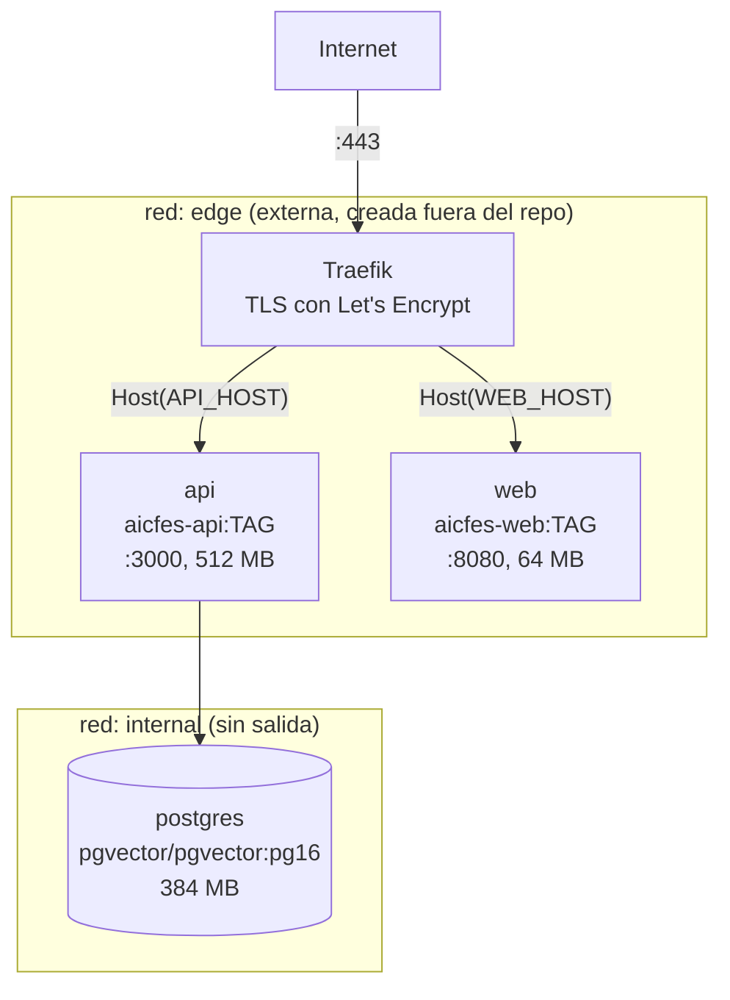
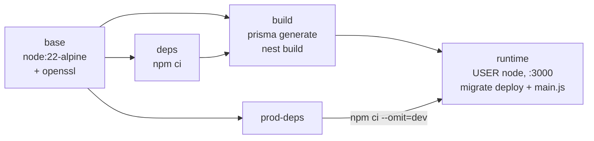
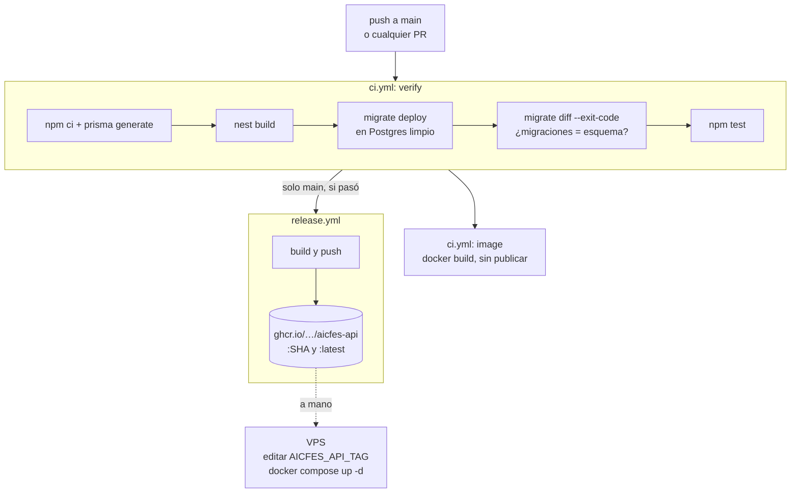

# Infraestructura

Dónde corre esto, con qué configuración y cómo se despliega.

Todo leído de `Dockerfile`, `deploy/compose.yml`,
`src/config/env.validation.ts` y `.github/workflows/`. Si algo no
coincide, el archivo manda.

---

## Qué corre en el VPS



**Ningún servicio publica puertos.** Lo único alcanzable desde internet
es lo que Traefik enruta por nombre de dominio. Postgres vive en una red
sin salida: no se puede llegar a él ni desde el propio host.

Traefik y la red `edge` **no están en este repo**. El compose solo
declara etiquetas; quien crea el proxy es otra cosa en el servidor.

### El endurecimiento, y lo que no cubre

`api` y `web` corren con:

| Medida | Qué impide |
|---|---|
| `read_only: true` | escribir en el disco del contenedor |
| `tmpfs: [/tmp]` | ...salvo en `/tmp`, que se borra al reiniciar |
| `cap_drop: [ALL]` | toda capacidad del kernel |
| `security_opt: no-new-privileges` | escalar privilegios |
| `USER node` | correr como root |

**Postgres no tiene ninguna de estas.** Es deliberado en parte (una base
de datos necesita escribir), pero `cap_drop` y `no-new-privileges` sí se
le podrían aplicar. Queda anotado.

Tampoco hay `pids_limit` ni perfiles de seccomp propios.

---

## Dos defectos conocidos

Documentados porque son silenciosos, que es lo que los hace peligrosos.

### 1. `prisma` es una dependencia de desarrollo y el arranque la usa

```dockerfile
RUN npm ci --omit=dev          # quita prisma
CMD ["sh", "-c", "npx prisma migrate deploy && node dist/main.js"]
```

`npx` intentaría descargar el CLI al arrancar, con el sistema de
archivos en solo lectura y únicamente `/tmp` escribible. Hoy funciona
—lo que sugiere que algo lo resuelve, probablemente la caché del
`prisma generate` de la etapa anterior— pero **es frágil por accidente,
no por diseño**: depende de un detalle que nadie eligió.

Arreglo: mover `prisma` a `dependencies`, o correr las migraciones como
un trabajo aparte en vez de en el arranque de cada réplica.

### 2. Una variable que no llega al contenedor falla en silencio

`compose.yml` tiene que listar **cada** variable que el servicio
necesita. Si falta una, no hay error: el código usa su valor por
omisión y nadie se entera.

Pasó con `CUOTA_DIARIA_PAGO_USD`, que faltaba mientras `pago` era solo
un tipo de TypeScript. En el momento en que `User.plan` se volvió una
columna, un estudiante de pago habría recibido el tope que diga el
código.

Hay una prueba que lee `compose.yml` y exige que esas claves estén
(`test/cuota.test.ts`). **Añadir una variable nueva implica añadirla
también ahí**, o el hueco vuelve.

Nota adicional: `${VAR:-}` produce cadena vacía, y `Number('')` es `0`,
que el código rechaza y sustituye por su propio valor por omisión. El
efecto es el mismo que no pasarla.

---

**Una variable en `.env` no llega al contenedor por sí sola.** Compose
solo pasa las que `compose.yml` declara en `environment:`. Un secreto
que está en `.env` y no en esa lista no llega a ninguna parte, y la
aplicación falla como si el secreto fuera incorrecto. Ya pasó con
`MODERACION_TOKEN`. Para comprobarlo sin imprimir el valor:

```bash
docker compose exec -T api sh -c 'echo ${#MI_VARIABLE}'
```

Y `docker compose up -d api` **no recrea** el contenedor si la imagen
no cambió, así que un cambio solo en `.env` necesita
`--force-recreate`. Si la salida dice `Running` y no `Recreated`, no
se aplicó.

## Variables de entorno

### Obligatorias

El arranque falla si falta alguna (`src/config/env.validation.ts` con
Zod, conectado en `app.module.ts`).

| Variable | Para qué |
|---|---|
| `OPENAI_API_KEY` | generar preguntas y escribir planes |
| `JWT_SECRET` | firmar los tokens de sesión |
| `DATABASE_URL` | Prisma. No la valida Nest, la exige Prisma |

En el compose, además: `POSTGRES_PASSWORD`, `AICFES_API_TAG`,
`API_HOST`, `AICFES_WEB_TAG`, `WEB_HOST`, con `${VAR:?}` para que el
despliegue falle en vez de arrancar mal.

### Con valor por omisión

| Variable | Omisión | Para qué |
|---|---|---|
| `OPENAI_MODEL` | `gpt-5-mini` | genera las preguntas |
| `OPENAI_TIMEOUT_MS` | `180000` | cuánto espera al modelo |
| `OPENAI_FEEDBACK_MODEL` | `gpt-4o-mini` | escribe el plan |
| `OPENAI_VERIFIER_MODEL` | `gpt-5` | verifica del mismo proveedor |
| `OPENAI_TUTOR_MODEL` | `gpt-5-mini` | el tutor |
| `ANTHROPIC_API_KEY` | — | sin ella, no hay verificación cruzada |
| `ANTHROPIC_VERIFIER_MODEL` | `claude-opus-5-5` | verifica de otra familia |
| `VERIFY_ANSWERS` | `true` | `'false'` apaga la verificación |
| `DEDUP_THRESHOLD` | `0.92` | cuánto parecido es duplicado |
| `JWT_EXPIRES` | `7d` | vida del token de acceso |
| `REFRESH_TOKEN_EXPIRES_DAYS` | `30` | vida del de renovación |
| `REFRESH_COOKIE_NAME` | `refresh_token` | para la web |
| `ACCESS_COOKIE_NAME` | `access_token` | para la web |
| `CUOTA_DIARIA_GRATIS_USD` | `0.25` | tope diario gratis |
| `CUOTA_DIARIA_PAGO_USD` | `3.00` | tope diario de pago |
| `CUOTA_DIARIA_SEMILLA_USD` | `10.00` | para llenar el banco |
| `COSTO_ESTIMADO_PREGUNTA_USD` | `0.009` | medido, no supuesto |
| `USUARIOS_SEMILLA` | vacío | ids separados por coma |
| `MODERACION_TOKEN` | vacío | abre la cola de denuncias; vacío la cierra |
| `MAX_ITEMS` | `25` | tope de ítems por petición |
| `BODY_LIMIT` | `1mb` | tamaño máximo de petición |
| `CORS_ORIGIN` | `*` | lista separada por comas |
| `PORT` | `3000` | |
| `FEEDBACK_COOLDOWN_MINUTES` | `20` | entre regeneraciones |
| `NODE_ENV` | `development` | en `production`, cookies seguras |

**`MAX_RETRIES`** está validada y **nadie la lee**. Es código muerto.

**`CORS_ORIGIN` por omisión es `*`**, que con `credentials: true`
refleja cualquier origen. En producción el compose la fija al dominio
de la web, pero el valor por omisión es laxo y conviene cambiarlo.

---

## El Dockerfile, por etapas



El `runtime` copia `node_modules`, `dist`, `prisma`, `prompts` y
`package.json`. **No copia `public/`** (que `main.ts` sirve como
estáticos) ni `scripts/`: ni la interfaz suelta ni los scripts de carga
existen dentro de la imagen.

No hay `HEALTHCHECK` en el Dockerfile; vive en el compose.

---

## CI y despliegue



**No hay despliegue automático, a propósito.** El CI publica la imagen;
ponerla en producción es cambiar una etiqueta en `deploy/.env`. Como las
dos imágenes coexisten, volver atrás también es cambiar una etiqueta.

El paso `migrate diff` es el que hace cierto el
[ADR 2](adr/0002-migrations-are-the-source-of-truth.md): una migración
escrita a mano que no describa exactamente el esquema rompe el CI.

La imagen de la web se construye en **otro repo**.

---

## Runbook

### Dónde vive

| | |
|---|---|
| Servidor | `aitera-vps` en `~/.ssh/config` (usuario `diego`) |
| Directorio | `/home/diego/apps/aicfes/deploy` |
| Compose | `/home/diego/apps/aicfes/deploy/compose.yml` |

El mismo VPS corre otros proyectos, así que los comandos de compose
tienen que ejecutarse **desde ese directorio** o apuntar a ese archivo:
`docker compose ls` los lista todos.

Esto no estaba escrito en ninguna parte y hubo que buscarlo. Si el
servidor cambia, cambiar esta tabla.

### Desplegar una versión nueva

```bash
ssh aitera-vps
cd /home/diego/apps/aicfes/deploy

# 1. Ver qué etiqueta hay ahora, para poder volver
grep AICFES_API_TAG .env

# 2. Poner la nueva (el SHA del commit, no :latest —
#    una etiqueta móvil no dice a qué volver)
# El SHA COMPLETO, 40 caracteres. El CI etiqueta las imágenes así, y
# el abreviado no existe en el registro: `docker compose up` falla con
# "failed to resolve reference" y deja corriendo la versión anterior.
# Obtenerlo con: git rev-parse origin/main
sed -i 's/^AICFES_API_TAG=.*/AICFES_API_TAG=<sha-completo-de-40>/' .env

# 3. Levantar solo la API
docker compose up -d api

# 4. Confirmar que arrancó y que la base respondió
docker compose logs -f api
curl -s https://<API_HOST>/api/health
```

Las migraciones corren en el arranque del contenedor
(`migrate deploy`). Son forward-only: **no hay reversa**.

### Volver atrás

```bash
sed -i 's/^AICFES_API_TAG=.*/AICFES_API_TAG=<sha-anterior-completo>/' .env
docker compose up -d api
```

Eso devuelve el código. **No devuelve el esquema**: si la versión nueva
corrió una migración, la vieja se encuentra una base más nueva que ella.
Por eso una migración que quite o renombre algo necesita dos
despliegues (añadir, migrar, y solo después quitar).

### Respaldos

**No hay respaldo automático configurado en este repo.** Es el hueco más
serio de esta página: las migraciones son forward-only, así que el
respaldo *es* el plan de reversa.

Manualmente:

```bash
# El usuario es `aicfes`, no `postgres` (POSTGRES_USER en compose.yml).
# Con `postgres` falla: role "postgres" does not exist — y falla DESPUÉS
# de crear el archivo, así que deja un .gz de 20 bytes que parece un
# respaldo.
docker compose exec -T postgres \
  pg_dump -U aicfes aicfes | gzip > ~/aicfes-$(date +%F).sql.gz

# Comprobar que sirve, no sólo que existe. Un pg_dump que falla deja
# igualmente un archivo.
ls -lh ~/aicfes-*.sql.gz
gunzip -c ~/aicfes-$(date +%F).sql.gz | grep -c "CREATE TABLE"   # ≥18
```

Un respaldo que nunca se restauró no se sabe si sirve. Conviene probar
la restauración en una base aparte antes de necesitarla.

El 23 nov 2026 el primer intento de respaldo de este runbook falló por
usar `-U postgres`, y produjo un `.gz` de 20 bytes. El `ls` lo
delató. Esa es la razón de las dos comprobaciones de arriba: aquí el
fallo no es que no haya archivo, es que lo hay y está vacío.

### Mirar qué pasa

```bash
# Logs (json-file, 10 MB × 3 por servicio)
docker compose logs --tail=100 api

# Salud de los contenedores
docker compose ps

# La base, desde dentro
docker compose exec postgres psql -U aicfes -d aicfes
```

**`/api/health` no consulta la base**: puede responder 200 con Postgres
caído. Para saber de verdad, la consulta de arriba.

---

## Desarrollo local

```bash
cp .env.example .env     # y poner OPENAI_API_KEY y JWT_SECRET
npm ci
npx prisma migrate deploy
npm run start:dev        # :3000, con recarga
npm test                 # node --test con ts-node
```

O todo en Docker:

```bash
docker compose -f deploy/compose.yml up -d
```

Documentación de la API en `/api/docs` (Swagger). Está **pública en
producción**, lo que expone el mapa completo de endpoints; conviene
cerrarla o protegerla.

---

## Ver también

- [Arquitectura](ARQUITECTURA.md)
- [Modelo de datos](MODELO-DE-DATOS.md)
- [Decisiones (ADR)](adr/)
