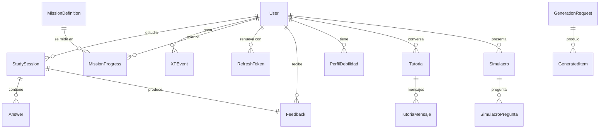
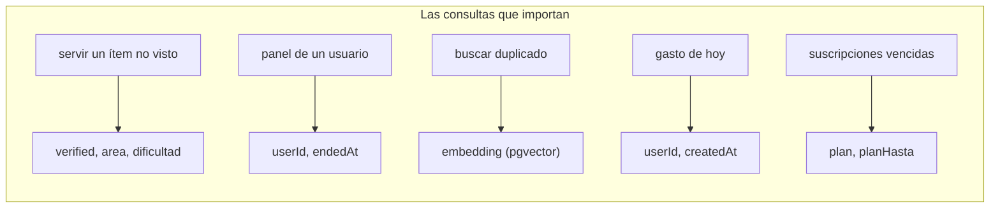

# Modelo de datos

PostgreSQL 16 con la extensión `pgvector`. 18 tablas, 9 enumeraciones,
16 migraciones.

La fuente de verdad es `prisma/migrations/`, no este documento ni el
esquema: ver
[ADR 2](adr/0002-migrations-are-the-source-of-truth.md). Si algo aquí
no coincide con una migración, este documento está mal.

---

## Entidades y relaciones

Todas esas relaciones son `onDelete: Cascade`: borrar un usuario se
lleva lo suyo.

### Tres tablas sin relación

`TimeTrialMode`, `ItemReferencia` y `ConsumoLlm` no apuntan a nada ni
nada les apunta con llave foránea. No es un olvido:

- **`TimeTrialMode`** es un catálogo. Su `id` es una cadena legible
  (`ritmo-real`), y una sesión terminada guarda ese texto para seguir
  describiendo bajo qué modo se jugó incluso si el modo se retira.
- **`ItemReferencia`** son los ~2.400 ítems de cuadernillos oficiales.
  Son evidencia para generar y **nunca se sirven a un estudiante**.
- **`ConsumoLlm`** es el libro de costos. Guarda `userId` como texto
  suelto a propósito: un registro de gasto tiene que sobrevivir al
  borrado de la cuenta que lo causó, o se pierde la contabilidad.

---

## Las referencias blandas, y por qué importan

Tres columnas apuntan a `GeneratedItem.id` **sin llave foránea**:

| Tabla | Columna | Línea |
|---|---|---|
| `Answer` | `itemId` | `schema.prisma:196` |
| `Tutoria` | `itemId` | `schema.prisma:249` |
| `SimulacroPregunta` | `itemId` | `schema.prisma:449` |

Significa que la base **no impide** que apunten a un ítem que ya no
existe, y que borrar un ítem no borra en cascada las respuestas que lo
mencionan.

Eso conviene al historial: una respuesta dada en octubre sigue siendo
cierta aunque el ítem se haya retirado después. Pero tiene un costo
real que hay que conocer antes de escribir una consulta: **un `join`
contra `GeneratedItem` puede no encontrar nada**, y el código tiene que
tratar eso como un caso normal, no como un error.

Los ítems se retiran (`retirado`, `motivoRetiro`), no se borran, justo
para que esto casi nunca pase.

---

## Las tablas, por lo que hacen

### Quién es quién

**`User`** — `id` cuid, `email` único y *nullable*, `passwordHash` y
`passwordSalt`, `timezone`, y desde hoy `plan` (`gratis` | `pago` |
`semilla`) con `planHasta`.

El correo es nullable porque hubo cuentas antes de que hubiera registro.
La zona horaria no es cosmética: decide qué día es "hoy" para la racha y
para la pregunta del día — en UTC, la medianoche cae a las 7 de la tarde
en Colombia.

**`RefreshToken`** — guarda `tokenHash`, nunca el token. Con `revokedAt`
para poder cortar una sesión.

### El banco de preguntas

**`GenerationRequest`** — una petición al modelo: qué se pidió, qué
estado tiene, y `rawModelOutput` con el texto crudo por si hay que
entender un fallo. Esa columna es la que estuvo expuesta sin
autenticación (ver
[ADR 9](adr/0009-every-route-that-spends-or-reveals-requires-a-session.md)).

**`GeneratedItem`** — la pregunta. Lo que importa:

| Campo | Para qué |
|---|---|
| `opciones`, `respuesta_correcta` | la pregunta en sí |
| `explicaciones` | por qué cada opción es lo que es |
| `verified`, `verifierAnswer` | lo resolvió otro modelo y coincidió |
| `questionHash` único | el mismo enunciado no entra dos veces |
| `embedding vector(1536)` | y uno *parecido* tampoco |
| `timesServed`, `lastServedAt` | para servir lo menos visto |
| `vecesRespondido`, `vecesCorrecto` | dificultad medida, no supuesta |
| `retirado`, `motivoRetiro` | se jubila, no se borra |
| `figura` | `{plantilla, parametros}`, el SVG se dibuja al servir |

Solo se sirve lo que tiene `verified = true`.

**`ItemReferencia`** — los cuadernillos reales, con su propio embedding
para buscar por parecido semántico.

### Lo que el estudiante hace

**`StudySession`** — un intento: modo, área, cuándo empezó y terminó,
cuántas acertó, y cuánto XP se otorgó por aciertos y por tiempo
separados.

**`Answer`** — cada respuesta, con `tiempoMs`. Ese dato es lo que
convierte "falló" en "falló apurado" o "falló pensándolo".

**`Simulacro`** y **`SimulacroPregunta`** — el examen completo. La
pregunta guarda `marcada`, para volver, y `orden` único por simulacro.

**`Tutoria`** y **`TutoriaMensaje`** — una conversación por estudiante y
pregunta (`unique(userId, itemId)`), con la defensa que escribió el
estudiante antes de ver la explicación. El hilo sobrevive entre
intentos.

### Lo que lo hace entretenido

**`XPEvent`** — un libro mayor, no un contador: cada premio guarda su
`amount`, su `reason` (`session_correct`, `time_trial_bonus`,
`mission_completed`) y su `meta`. Se puede auditar de dónde salió cada
punto.

Eso es justamente lo que permite **explicar** el XP en vez de solo
mostrar un total, que es la única forma de gamificación con efecto
positivo medido (ver
[ADR 10](adr/0010-informative-feedback-over-rewards-for-finishing.md)).

**`MissionDefinition`** y **`MissionProgress`** — cinco misiones
diarias. El progreso lleva `date` como texto y `unique(userId,
missionId, date)`: la misma misión del mismo día no se completa dos
veces.

### Lo que el sistema sabe de sí mismo

**`PerfilDebilidad`** — por usuario, área y tema: cuántas respondió,
cuántas acertó, qué tipo de error comete. Es lo que decide qué preguntar
en contrarreloj y en el peaje.

**`ConsumoLlm`** — cada llamada a un modelo con su costo en
`costoMilicent` (enteros, milésimas de centavo: un float acumula error).

---

## Dónde están los índices

**Un hueco conocido:** las columnas `embedding` están declaradas como
`Unsupported("vector(1536)")` y **no hay índice HNSW ni IVFFlat** en
ninguna migración. Cada búsqueda de duplicado recorre el área entera.
Con el banco actual (326 ítems servibles, ~2.400 de referencia) no se
nota; con diez veces más, sí.

---

## Las migraciones

16, en orden cronológico. Solo una toca algo existente:
`20260113181155_fix_foreign_key_reference` quita y vuelve a poner la
llave foránea de `GeneratedItem` hacia `GenerationRequest.requestId`.
Ninguna borra tablas, columnas ni datos.

La llave de esa relación es `requestId` (el texto), no `id`. Vale
saberlo antes de escribir una consulta.

**Son forward-only.** No hay migración de reversa. Volver atrás es
restaurar un respaldo, lo que hace que el respaldo sea parte del plan de
despliegue y no un extra.

---

## Ver también

- [Arquitectura](ARQUITECTURA.md) — los módulos y los flujos
- [Infraestructura](INFRAESTRUCTURA.md) — dónde corre esto
- [Decisiones (ADR)](adr/)
